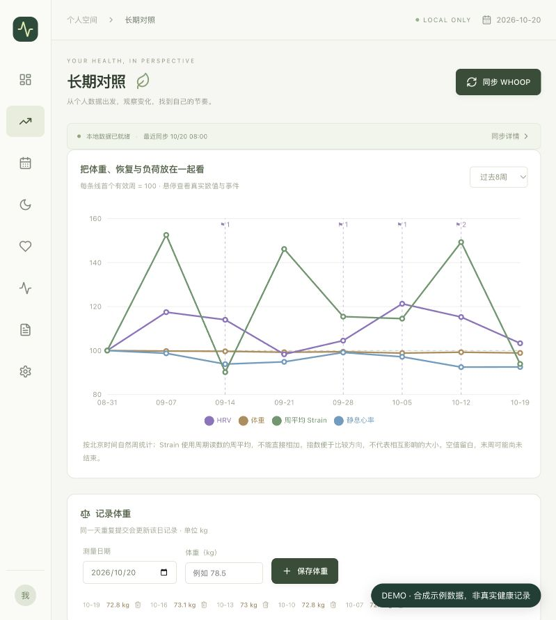
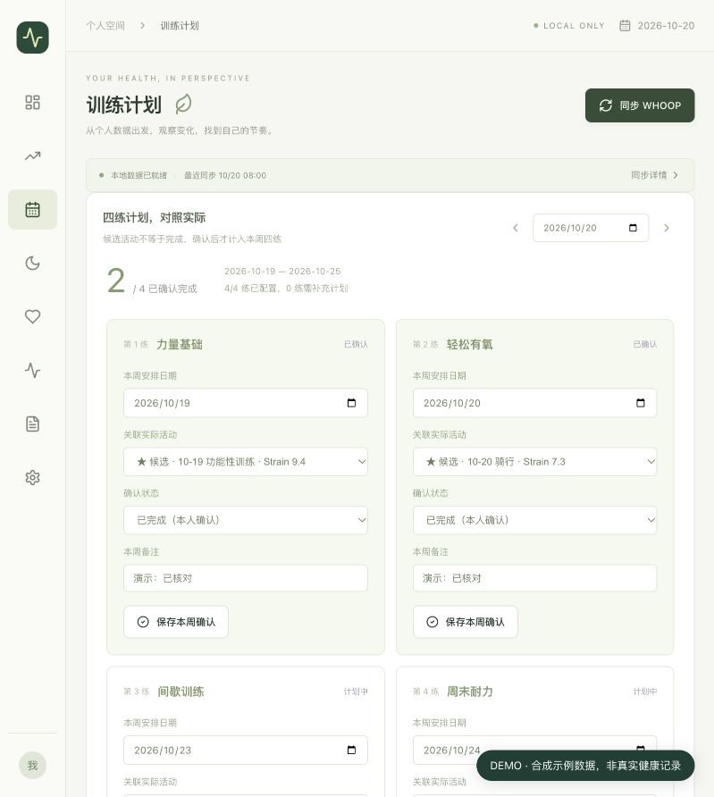
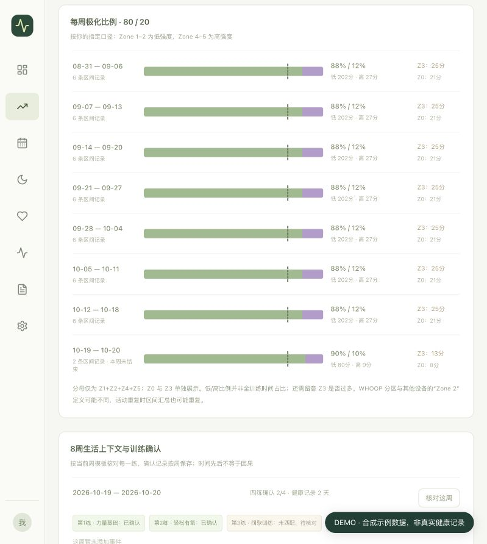
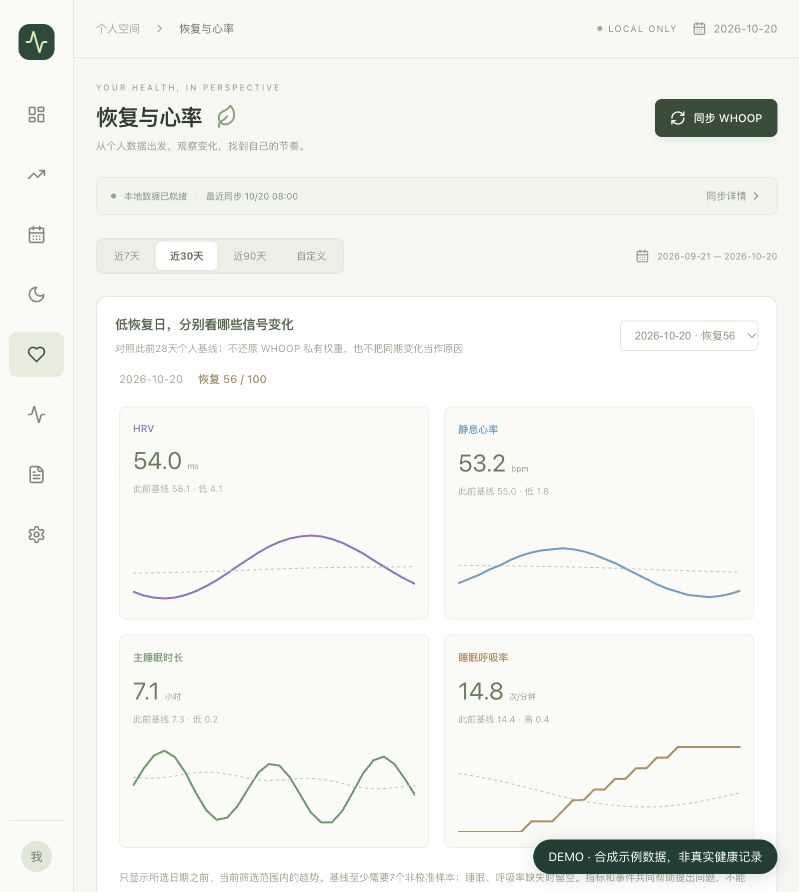
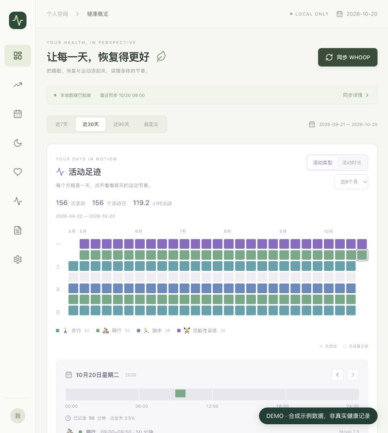

# WHOOP Health Dashboard

把身体数据、训练计划和生活背景，放在同一张时间线上。

一个基于 **React + TypeScript · FastAPI · SQLite** 的个人健康分析看板。读取 WHOOP 数据，补充手动体重、训练确认与事件记录，面向长期复盘，而不只是查看当天分数。

> 本项目是非官方的补充分析工具，不替代 WHOOP 设备、账号或原生应用。下列截图均来自项目实际界面，使用完全合成的演示数据，非本人或其他人的健康记录；截图中的结果不代表训练效果。



## 为什么做这个看板

当问题从“今天恢复多少分”，变成“过去八周，我的体重、恢复与训练安排怎样一起变化”，需要的不只是更多数字，还包括：

- 把不同指标放在同一时间轴，减少来回切换。
- 把自己写下的训练计划，与实际记录到的活动逐项核对。
- 按明确的统计口径汇总区间时间，知道比例到底怎么算。
- 记录训练调整、出行和作息变化，给曲线留下上下文。
- 保留自己的数据副本、查询逻辑与导出结果，便于持续扩展。

## 与 WHOOP 原生应用的侧重点差异

WHOOP 已提供趋势分析、Journal 行为洞察和 Weekly Plan。本项目的价值是**围绕个人工作流重新组合数据，并开放统计过程**，而不是宣称 WHOOP 没有这些能力。

| 关注的问题 | WHOOP 原生应用的相关能力 | 本项目的实现侧重点 |
| --- | --- | --- |
| 长期变化 | 睡眠、恢复与 Strain 的趋势视图 | 体重、HRV、静息心率、周平均 Strain 同轴对照，并显示事件标记 |
| 训练执行 | Weekly Plan 提供个性化指标、行为和活动目标 | 四练模板、具体安排日期、Workout 候选匹配，以及本人确认的完成状态 |
| 生活背景 | Journal 支持行为记录及相关影响分析 | 自由文本事件、日期/时间/类别、逐日备注，与每周训练确认一起回看 |
| 统计方法 | 官方评分与原生洞察 | 可查看源码中的有效样本、基线、环比、分区分母与日期对齐规则 |
| 数据工作流 | 设备采集与官方产品体验 | 本地或自托管 SQLite、快照归档、手动补充数据及 CSV / JSON / Markdown 导出 |

官方能力参考：[Trend Views](https://www.whoop.com/us/en/thelocker/track-progress-with-new-trend-views/)、[WHOOP Journal](https://www.whoop.com/us/en/thelocker/the-whoop-journal/)、[Weekly Plan](https://www.whoop.com/us/en/thelocker/set-and-reach-your-goals-with-weekly-plan/)。以上为 2026-10-20 查阅时的说明，不是完整的功能对比；官方功能可能继续变化。

## 核心功能与界面

### 1. 跨指标长期对照

按周对照体重、HRV、静息心率与周期 Strain，支持 8 / 12 / 24 周视图。体重由自己记录；每条线以首个有效周为 100，便于比较变化方向，悬停可查看原始数值和事件。

这张图帮助提出问题，而不是证明体重变化造成了 HRV 或恢复变化。

### 2. 计划 vs 实际

设置每一练的名称、星期和类型，结合 WHOOP 实际 Workout 查找候选，再确认完成、调整日期或标记跳过。确认结果按周保存，未匹配不等于未训练，候选也不等于已完成。



### 3. 每周低强度 / 高强度比例

汇总每个 Workout 的心率区间时间，以 **Z1–2 / Z4–5** 对照 80/20 参考线，并单独列出 Z0、Z3 和样本数量，避免只看一条比例就下结论。



### 4. 恢复相关指标分开看

选定一天，对照此前 28 天个人基线，分别查看 HRV、静息心率、主睡眠时长和睡眠呼吸率的变化及趋势。

这里不重算恢复分，不还原 WHOOP 私有评分权重，也不会精确声称“某指标导致少了多少分”。



### 5. 活动日历与生活上下文

用活动类型或时长为日历配色，点击一天查看 24 小时时间轴；添加逐日备注，或在长期对照里按日期、时间和类别记录事件，再结合指标与训练状态回看。



## 数据统计上的优势：过程明确、结果可核对

本项目不声称比 WHOOP 的官方评分更准确。优势在于：**你能知道每个数字使用了哪些样本、什么时间范围，以及什么计算口径。**

| 统计问题 | 当前处理方式 |
| --- | --- |
| 没记录的日期怎么办？ | 缺失值留白，不当作 0；每项指标使用自己的有效样本数 |
| 与上期怎么比较？ | 对照前一个等长时段，同时显示本期与前期样本量 |
| 主睡眠和补觉如何区分？ | 按睡眠结束日期归日，主睡眠与 Nap 分开统计；长补觉等异常保留核对提示 |
| 个人基线是否用了当天数据？ | 使用该日期之前 28 天的非校准记录，至少需要 7 个有效样本 |
| 周 Strain 是否直接相加？ | 不相加：日级取关联周期的最大读数，周级使用这些读数的均值；生理周期不等于自然日 |
| 不同单位为什么能画在一起？ | 长期图将各指标首个有效周设为 100；指数不代表指标间影响大小，也不等于相关系数 |
| 80/20 的分母是什么？ | 低强度比例 = `(Z1 + Z2) / (Z1 + Z2 + Z4 + Z5)`；Z0、Z3 单独显示，不计入这个分母 |
| 活动时间重叠怎么办？ | 日历中的每日活动总时长按时间区间合并，不重复累计重叠部分 |
| 出现相关性就能解释原因吗？ | 不能；相关系数至少需要 10 对有效样本，仍只用于描述性观察 |

注意：当前日期口径固定为 `Asia/Shanghai`；心率区间采用 WHOOP 提供的区间，未重新定义生理训练区。80/20 是当前自定义对照口径，并非全训练时间的低/高强度占比，Z3 很多时仍需单独关注。重复的 Workout 可能使每周区间汇总重复；活动类型或高强度分钟数也不能确认具体动作、组数或某次间歇是否严格执行。

相关实现：[基础指标与口径](backend/analysis.py)、[长期与训练核对](backend/insights.py)、[活动日历与重叠时间合并](backend/activity.py)。

## 数据流与技术组成

```text
WHOOP Developer API → Python 同步与归档 → SQLite → FastAPI → React 看板
                                             ↑
                                  手动体重 / 训练确认 / 事件备注
```

- 前端：React 19、TypeScript、Vite、Recharts。
- 后端：FastAPI、Uvicorn，WHOOP OAuth 与数据拉取使用 Python 标准库。
- 存储：SQLite，保留同步、归档和个人记录的代码实现。
- 导出：CSV、JSON、Markdown，可在浏览器打印报表。

## 后续方向（尚未实现）

- 接入 DeepSeek 等模型，提供按需触发的日报、周报和数据问答。
- 在明确同意后，组合个人目标、指标摘要、事件与对话上下文；API Key 只保存在后端。

当前版本未接入大模型，现有分析由项目代码完成，不会将健康数据自动发送给 AI 服务。

## 仓库范围

本仓库包含前后端源码、依赖清单、通用前端构建文件及 `docs/images/` 下的合成数据界面截图。不包含真实健康数据、数据库、报表、WHOOP 授权令牌、环境变量文件、服务器部署配置、SSH 密钥、镜像或本机路径。演示用数据库和数据生成脚本也不随截图上传。

`whoop.py`、`weekly.py`、`report.py` 是后端使用的同步、归档与报表模块，保留在根目录。

## 本地开发

使用 Python 3.12 和 Node.js 22。

在根目录安装后端依赖并启动：

```bash
python3 -m venv .venv
source .venv/bin/activate
pip install -r requirements.txt
python -m uvicorn backend.app:app --host 127.0.0.1 --port 8000
```

在另一个终端启动前端：

```bash
cd frontend
npm ci
npm run dev
```

前端开发服务器将 `/api` 和 `/callback` 转发到本机后端。也可以在 `frontend` 中执行 `npm run build`，随后从后端的 `http://127.0.0.1:8000` 查看构建后的页面。

初次启动没有个人数据，这是预期行为。WHOOP 同步需要在本机自行设置 `WHOOP_CLIENT_ID`、`WHOOP_CLIENT_SECRET` 和 `WHOOP_REDIRECT_URI`，通过环境变量或不纳入版本管理的 `.env` 提供。密钥、授权令牌、数据库和运行结果都不能提交到仓库。

## 安全说明

默认开发模式仅用于本机回环地址。不要直接将无认证开发服务暴露到公网。

后端保留服务器认证与 Tailscale 专用访问模式的实现，但实际网络绑定、凭据及访问策略应在部署环境单独管理，本仓库不提供个人服务器配置。

健康记录与 OAuth 令牌当前没有应用层静态加密；Tailscale 免登录依赖受控设备和访问策略，并不提供多用户权限隔离。公开源码不会自动公开你部署的服务，也不意味着应该关闭服务的访问保护。

完整说明见 [SECURITY.md](SECURITY.md)。提交代码或截图前请阅读 [贡献指南](CONTRIBUTING.md)；切换仓库为公开前请核对 [发布检查表](docs/PUBLIC_RELEASE.md)。

健康分析用于个人趋势观察，不构成医疗诊断；指标间的相关性不代表因果。

## 许可证与归属

本项目采用 [MIT 许可证](LICENSE)，允许在保留版权及许可声明的前提下使用、修改和分发，不提供担保。第三方依赖继续适用各自许可证；WHOOP 名称与商标属于其权利人，本项目未获 WHOOP 官方背书。
